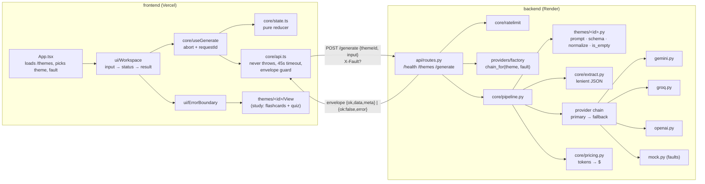

# Structured AI: study assistant

Paste notes or name a topic. An LLM turns it into **flashcards and a multiple-choice quiz** that you can flip, mark, answer, score and re-test. It's not a chatbot: the model's output is validated JSON that drives a stateful UI.

The interesting part is the generic module underneath it. Any theme (study, recipe, trip…) gets reliable structured output from an unreliable LLM. Malformed, truncated, wrong-shape, empty, slow, rate-limited and failed responses all become a typed, recoverable UI state. Stale responses never overwrite newer ones.

- **Backend:** FastAPI + Pydantic v2 (Python 3.12). Gemini, Groq and OpenAI via their official SDKs, with fallback.
- **Frontend:** React 19 + TypeScript + Vite. A hand-written state machine; no React Query or Redux.
- **Tests:** 142 pytest + 57 Vitest.

Design docs: [main-problem.md](main-problem.md) (problem and failure taxonomy) and [plan.md](plan.md) (decisions and contract).

---

## Run it

Needs Node 20+ and [uv](https://docs.astral.sh/uv/). uv installs Python 3.12 itself.

```bash
# 1. backend (http://localhost:8000)
cd backend
cp .env.example .env          # add at least one API key, or set LLM_PROVIDER=mock
uv sync
uv run uvicorn app.main:app --reload

# 2. frontend (http://localhost:5173), from the repo root
npm install && npm start
```

- `npm start` runs the frontend against `VITE_API_URL`, which defaults to `http://localhost:8000`. To use a hosted backend instead, set it in `frontend/.env` (see `frontend/.env.example`).
- With `LLM_PROVIDER=mock` no key is needed: every request returns the theme's example output.
- The **Fault injection** dropdown (top right in dev, or add `?debug` to the URL) triggers every failure mode on demand. It needs `ALLOW_FAULTS=true` on the backend.

**Tests:**
```bash
cd backend && uv run pytest -q && uv run ruff check .
cd frontend && npm run check      # tsc + oxlint + prettier + vitest
```

---

## Architecture

### What calls what



### One request, end to end

```mermaid
sequenceDiagram
  participant U as User
  participant H as useGenerate
  participant A as api.ts
  participant R as /generate
  participant P as pipeline
  participant L as LLM chain
  U->>H: generate(input)
  H->>H: abort previous, requestId++, dispatch start
  H->>A: generate(themeId, input, signal)
  A->>R: POST (45s client timeout)
  R->>R: rate limit · theme whitelist · body cap
  R->>P: run(theme, input, chain)
  P->>P: validate input, build prompt (server-side only)
  P->>L: attempt 1 (≤25s, deadline 40s total)
  L-->>P: raw text + token usage
  P->>P: extract JSON → Pydantic validate
  alt malformed / invalid shape, and >5s left
    P->>L: attempt 2: original prompt + bad output + errors
  end
  P->>P: normalize (ids, trim) → is_empty?
  P-->>A: envelope + meta {provider, attempts, repaired, usage}
  A-->>H: Result (or network / bad_response / client_timeout / aborted)
  H->>H: dispatch resolve(requestId); reducer drops it if stale
  H-->>U: success → View · empty · error (retry / countdown)
```

### Responsibilities

| | Backend owns | Frontend owns |
|---|---|---|
| Security | API keys (env only), prompts built server-side (no open relay), theme whitelist, input cap, per-IP rate limit, CORS allowlist | Never sees a key |
| AI output | Lenient extraction, strict validation, one repair retry with the errors, normalize, empty check | Trusts the envelope, not the network |
| Providers | Primary + fallback chain, SDK retries off, per-call and total deadlines, exceptions mapped to one type | — |
| Lifecycle | — | Abort on new submit, cancel and unmount; requestId race guard; client timeout |
| UX | User-safe error messages per kind | Loading (cold-start hint) / error (retry, 429 countdown) / empty / result, ErrorBoundary, a11y, 360 px |

### Layout

```
backend/app/
  main.py                 app factory, CORS, catch-all → envelope, logging setup
  config.py               env settings
  api/schemas.py          request + envelopes (ThemeData = union of theme schemas → OpenAPI)
  api/routes.py           /health /themes /generate
  core/pipeline.py        the generate pipeline + repair + usage tally
  core/extract.py         fences / prose / string-aware balanced scan; truncated fails
  core/errors.py          ErrorKind → HTTP status
  core/deadline.py, ratelimit.py, pricing.py
  providers/              base (Provider, Completion, Usage, ProviderError), gemini, chat (groq+openai), mock, factory
  themes/                 base (Theme protocol), registry, study, echo
frontend/src/
  core/                   api.ts, api-types.ts (generated), errors.ts, state.ts, useGenerate.ts, format.ts
  ui/                     Shell, Workspace, InputPanel, LoadingView, ErrorView, EmptyView, ErrorBoundary, DevFaultPanel
  themes/                 registry.ts, study/{state.ts, View.tsx}, echo/View.tsx
```

**Types have one source of truth.** Pydantic models → `/openapi.json` → `npm run gen:api` → `src/core/api-types.ts`. When the backend adds an error kind or fault, the frontend fails to compile until it handles it.

---

## Handling bad AI output

| What the model does | What happens | UI |
|---|---|---|
| Wraps JSON in ```` ``` ```` fences or prose | Extracted; succeeds first try | Result |
| Invalid JSON, or truncated | `malformed`. One repair retry gets the bad output and the parse error | Result with an "auto-repaired" badge, or a Retry card |
| Valid JSON, wrong shape (missing fields, `answerIndex` out of range…) | `invalid_shape`. The repair retry gets compact `path: message` errors | Same as above |
| Valid but nothing useful (e.g. gibberish input) | `empty` | Empty state with a rephrasing tip |
| Blank options or duplicates in a question | `normalize` drops the question instead of guessing (dropping options would shift `answerIndex`) | Fewer questions |
| Provider 5xx / timeout / network | Fallback provider tried; then `provider` / `timeout` | Retry |
| Provider 429 on every provider | `rate_limited` with `retryAfter` | Countdown, then Retry |
| Slow | Deadline: 25 s per call, 40 s total; client gives up at 45 s | Spinner, Cancel, "waking up the server" after 5 s |
| Response isn't a valid envelope (proxy HTML, etc.) | `bad_response` on the client | Retry |
| A View crashes rendering valid data | ErrorBoundary | "Couldn't display this result" + Retry; the app stays usable |
| User submits A, then B | A is aborted; if A's response still arrives, the reducer drops it (requestId) | Always shows B |

Fallback never runs for bad output; the repair handles that. Truncated JSON is never "fixed" by guessing.

---

## Token usage and cost

Every successful response carries the usage summed over **every model call in that request**, including the repair attempt:

```json
"meta": { "attempts": 1, "provider": "groq", "model": "openai/gpt-oss-120b", "latencyMs": 3016, "repaired": false,
          "usage": { "inputTokens": 989, "outputTokens": 970, "costUsd": 0.00073035 } }
```

- **Tokens** are the provider's own counts. For Gemini, thinking tokens are counted as output because they're billed as output.
- **Cost** uses list prices in [`backend/app/core/pricing.py`](backend/app/core/pricing.py) (USD per 1M tokens, checked 2026-11-20):
  - `gpt-5.4-mini` $0.75 / $4.50
  - `openai/gpt-oss-120b` $0.15 / $0.60
  - `gemini-3.5-flash-lite` $0.30 / $2.50
- For an unknown model, `costUsd` is `null` rather than a guess. On a free-tier key the real charge is $0; the figure is what the same usage costs at list price.
- The mock reports no usage (`usage: null`).
- **The UI shows it** under each result: `groq · openai/gpt-oss-120b · 3.0s · 989 in · 970 out tokens · $0.000730`.

Typical cost of one study set: about $0.0007 (Groq), $0.0013 (Gemini), $0.003 (OpenAI).

---

## Logging

Backend: one line per request, plus one per provider failure or repair. The SDKs' per-HTTP-call INFO logs are silenced. Inputs and outputs are not logged.

```
INFO    app: started chain=groq:openai/gpt-oss-120b -> gemini:gemini-3.5-flash-lite faults=True cors=['http://localhost:5173']
INFO    app.pipeline: generate theme=study ok provider=groq model=openai/gpt-oss-120b attempts=1 repaired=False tokens=989in/970out cost=$0.000730 3016ms
INFO    app.pipeline: attempt 1 invalid_shape (quiz.0: Value error, answerIndex 9 is out of range for 4 options); repairing
WARNING app.pipeline: provider=gemini model=gemini-3.5-flash failed status=503 timeout=False 1469ms: gemini 503 UNAVAILABLE: This model is currently experiencing high demand…
INFO    app.pipeline: generate theme=study failed kind=empty attempts=1 tokens=962in/164out cost=$0.000243 1125ms
INFO    app.ratelimit: rate limited client=203.0.113.9 retry_after=43s
```

Frontend console: one line per request.

```
[generate #3] study ok 3051ms groq/openai/gpt-oss-120b attempts=1 · 989 in · 970 out tokens · $0.000730
[generate #4] study rate_limited 12ms: The AI service is busy. Try again shortly.
[generate #5] study superseded or cancelled after 840ms; result dropped        (console.debug)
```

---

## Configuration

`backend/.env` (or the repo-root `.env`; real env vars win):

| Var | Default | |
|---|---|---|
| `LLM_PROVIDER` | `mock` | `gemini` \| `groq` \| `openai` \| `mock`. A missing key for the primary fails at startup |
| `LLM_FALLBACK` | — | Another provider; skipped with a warning if its key is missing |
| `GEMINI_API_KEY` / `GROQ_API_KEY` / `OPENAI_API_KEY` | — | |
| `GEMINI_MODEL` / `GROQ_MODEL` / `OPENAI_MODEL` | `gemini-3.5-flash-lite` / `openai/gpt-oss-120b` / `gpt-5.4-mini` | Picked by measured latency and reliability (Nov 2026) |
| `CORS_ORIGINS` | `http://localhost:5173` | Comma-separated |
| `ALLOW_FAULTS` | `false` | Enables `X-Fault`, which only ever routes to the mock |
| `RATE_LIMIT_PER_MIN` | `10` | Per IP |
| `TOTAL_TIMEOUT_S` / `PROVIDER_TIMEOUT_S` | `40` / `25` | |

Frontend: `VITE_API_URL` (default `http://localhost:8000`).

## Deploy

- **Backend → Render:** Dashboard → New → Blueprint → this repo. [`render.yaml`](render.yaml) sets the build, the start command, the `/health` check and the defaults, and prompts once for the API keys and `CORS_ORIGINS`.
- **Frontend → Vercel:** root directory `frontend`, env `VITE_API_URL=<render url>`. Then add the Vercel URL to `CORS_ORIGINS` on Render.

## Adding a theme

1. Backend: `app/themes/<id>.py` with a Pydantic schema, `build_prompt`, `normalize`, `is_empty` and an `example`. Then add one line to `themes/registry.py`.
2. Frontend: `npm run gen:api`, then write `themes/<id>/View.tsx` and add one line to `themes/registry.ts`.

No core changes. The study theme was added exactly this way, on top of the `echo` test theme.

---

## AI usage

Built with **Claude Code (Claude Opus 5.5)** as a pair programmer:

- **I decided the architecture:** FE/BE split, FastAPI, official SDKs, a repair retry rather than JSON-repair heuristics, a hand-rolled state machine, and the provider choices. These are written up in plan.md before any code.
- **Claude Code wrote the code and tests** step by step against that plan. Each step was tested, then committed (see [WORKLOG.md](WORKLOG.md)).
- **Bugs caught by tests or live runs, not by the AI's first draft:**
  - The extractor returned a nested fragment of truncated JSON.
  - Gemini rejects server deadlines under 10 s, which broke late repairs.
  - `gemini-2.5-flash` is retired for new keys.
  - A race test that only exercised the status check, not the requestId check.
- **Model defaults and prices** were chosen from live measurements and public pricing pages.

## Limitations

- **Rate limiting** is in memory and per instance, and resets on restart. Behind Render's proxy, the client IP comes from `X-Forwarded-For`, which a client could spoof.
- **Cost** uses a static list-price table; it ignores cached-input discounts and free tiers.
- **No streaming:** a result appears all at once. A free Render instance's cold start (30–50 s) is covered only by the "waking up" hint.
- **Study results aren't saved** between sessions, and there's no refinement loop ("make the quiz harder").
- **Validation is structural plus a few semantic checks** (`answerIndex` in range, non-blank and distinct options). It can't detect a factually wrong answer.
- **The real-AI path was verified live** with all three providers. Every failure path is covered by tests and the mock faults, but real-provider outages were simulated only for Gemini 503 → Groq fallback.

## Time spent

About **1 h 25 m** of AI-assisted build time (23:25 → 00:50 by commit timestamps), plus the earlier problem analysis and design discussion. Per-step breakdown in [WORKLOG.md](WORKLOG.md).
